  <picture>
    <source media="(max-width: 600px)" srcset="./assets/hero-mobile.svg">
    
  </picture>

  <a href="https://github.com/drabkb786?tab=repositories">Browse my repositories</a> &nbsp; · &nbsp;
  <a href="https://github.com/drabkb786/secure-vps-panel/issues">VPS project support</a>

## Projects

## Tools I work with

<picture>
  <source media="(max-width: 600px)" srcset="./assets/stack-mobile.svg">
  
</picture>

## Contributions

<picture>
  <source media="(max-width: 600px)" srcset="./assets/activity-mobile.svg">
  
</picture>

<picture>
  <source media="(max-width: 600px)" srcset="./assets/calendar-mobile.svg">
  
</picture>

About this profile

The cards use self-contained SVG animations. GitHub Actions refreshes the public contribution data each day.

Edit profile.json to change the introduction, skills and featured projects. The source is in scripts/.

Design references — [navi3582](https://github.com/navi3582) and [DenverCoder1](https://github.com/DenverCoder1). Original artwork and implementation for Abdul Basit.

